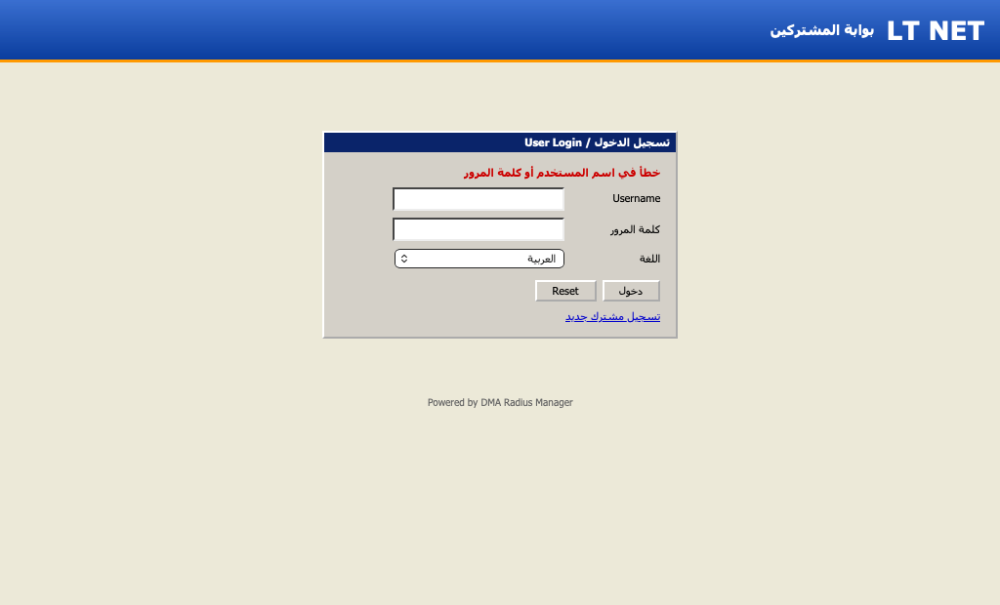
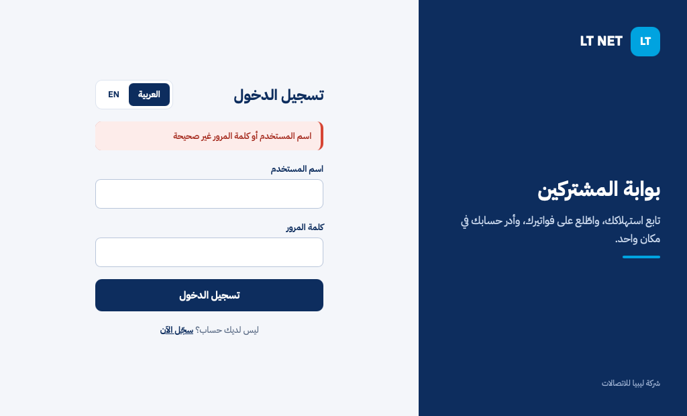
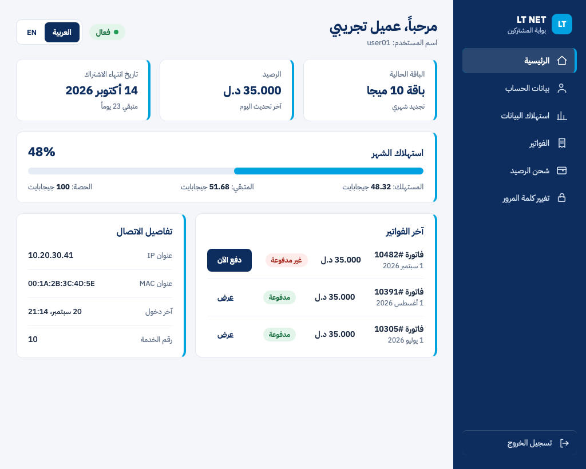

# lt-net-internship-2026

# LT NET Placement

Software engineering placement at Libya Telecom Co. (LT NET), an internet service provider in Misrata, Libya.
16 June to 18 August 2026, as part of COMPSCI4046 at the University of Glasgow.

I redesigned the customer portal and built an SMS alert system for tower outages.

## The company

LT NET sells home and business internet connections over a network of about 20 towers across Misrata. I worked alongside its software and network engineers.

## The two problems

- **Customers:** the portal was built on the DMA Radius Manager billing system. It was hard to use, had minimal branding, and was not designed to read right to left for Arabic.
- **Engineers:** the monitoring system checked whether each tower was up or down, but could not notify anyone. Someone had to watch the screen.

## Project 1: customer portal redesign

A frontend redesign in plain PHP, HTML, CSS and JavaScript, done with the design team on layout, colour and font. It mirrors properly for Arabic, has an Arabic and English toggle, and carries LT NET branding.

| Before | After |
| --- | --- |
|  |  |



*The dashboard after login, shown with a demo account.*

**Why a frontend redesign:** LT NET set the scope. DMA generates its own customer pages and is locked down, with no plugin system or vendor support to extend it. A new API layer was not realistic, so the redesign reuses DMA's existing API.

## Project 2: SMS alerts for tower outages

```
Monitoring database  ->  Python cron job  ->  SMS gateway (REST)  ->  SMS to engineer
```

1. The monitoring system stores each tower's up or down status.
2. A Python script runs on a schedule and checks the latest results.
3. It calls the Madar or Libyana SMS gateway (Libya's two mobile operators) with Python's `requests` library.
4. The engineer receives the tower name and a timestamp.

Recipient numbers are stored in a database, not in the script.

**Making it reliable:**

- **Tower goes down:** one SMS is sent, then the tower is marked as alerted so it does not repeat.
- **Tower recovers:** a "back up" SMS is sent and the flag is cleared.
- **Send fails:** only an HTTP 200 response counts as sent, so a failed send is retried on the next run.

**Status:** built and in testing with LT NET engineers.

## What I learned

- **Technical:** integrating real external services and working inside a legacy system I could not rebuild.
- **Practical:** understanding why a constraint like DMA's lockdown made the scope the right one.
- **Professional:** with real users, "working" means it helps them, not that it runs on my laptop.

## Note

Screenshots show a demo account, not a real customer. Source code, credentials and internal details are not included.
